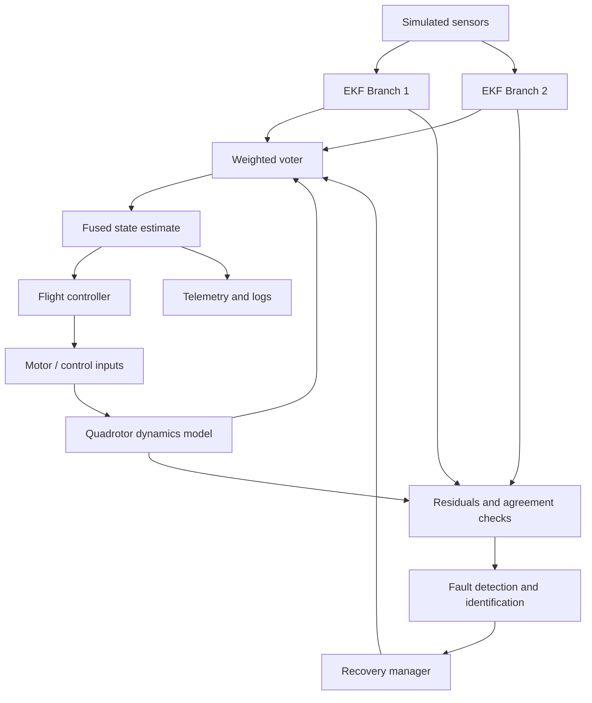

# Fault-Tolerant Data Fusion for a Quadrotor UAV

A simulation-based project that explores how a quadrotor can maintain
reliable state estimation when sensor measurements or estimator software
become faulty. The project combines redundant Extended Kalman Filters
(EKFs), an analytical quadrotor dynamics model, residual-based fault
detection, weighted voting, and recovery strategies in a ROS 2 and
Gazebo workflow, with supporting Python experiments and visualizations.

> **Research basis:** H. Hamadi, B. Lussier, I. Fantoni, and C. Francis,
> "Data fusion fault tolerant strategy for a quadrotor UAV under sensors
> and software faults," *ISA Transactions*, Vol. 129, pp. 520--539,
> 2022. <https://doi.org/10.1016/j.isatra.2022.01.007>

## Contents

-   [Project Goals](#project-goals)
-   [Key Features](#key-features)
-   [System Architecture](#system-architecture)
-   [Fault Scenarios](#fault-scenarios)
-   [Repository Structure](#repository-structure)
-   [Requirements](#requirements)
-   [Getting Started](#getting-started)
-   [Run the Python Experiments](#run-the-python-experiments)
-   [Run with ROS 2 and Gazebo](#run-with-ros-2-and-gazebo)
-   [Useful ROS 2 Topics](#useful-ros-2-topics)
-   [Results and Logs](#results-and-logs)
-   [Tests](#tests)
-   [Documentation](#documentation)
-   [Limitations](#limitations)
-   [Future Improvements](#future-improvements)
-   [Team](#team)
-   [Reference](#reference)

## Project Goals

Quadrotors depend on accurate estimates of position, velocity, and
orientation to fly safely. Sensor faults, noisy measurements, frozen
signals, or estimator software failures can cause the estimated state to
drift away from the real simulated state.

This project investigates a fault-tolerant estimation pipeline that aims
to:

1.  Compare independent state estimates and identify inconsistencies.
2.  Detect potential sensor and software faults using residuals and
    agreement indicators.
3.  Reduce the influence of unreliable estimation branches.
4.  Continue producing a fused state estimate using the remaining
    trusted information.
5.  Evaluate system behavior in controlled, repeatable simulation
    scenarios.

The project is intended for research and learning in robotics, state
estimation, fault detection, and simulation. It does **not** establish
flight safety for a real aircraft.

## Key Features

-   **Redundant estimation:** Two independent EKF branches provide
    separate state estimates.
-   **Analytical redundancy:** A Newton--Euler quadrotor dynamics model
    provides an additional estimate based on actuator commands.
-   **Fault injection:** Configurable sensor and software faults can be
    introduced during experiments.
-   **Fault detection and identification (FDI):** Residuals and
    branch-agreement measures help detect and classify inconsistent
    estimates.
-   **Weighted voting:** Estimates are combined according to their
    consistency rather than by unconditional averaging.
-   **Recovery logic:** The recovery manager can isolate an unreliable
    branch and select an alternative estimation strategy.
-   **Quaternion utilities:** Orientation operations account for
    quaternion representation and sign ambiguity.
-   **ROS 2 integration:** Launch files and nodes support simulation,
    estimation, diagnostics, control, and logging.
-   **Experiment outputs:** CSV logs and plots support comparison of
    baseline and fault-tolerant runs.
-   **Multiple Gazebo worlds:** Includes an open arena, narrow corridor,
    obstacle course, and fault-tolerance test world.
-   **Browser-based visualizations:** The repository includes HTML-based
    visualization assets.

## System Architecture



### Main processing stages

1.  **Sensor simulation / bridge:** Supplies simulated IMU, position,
    altitude, and orientation-related measurements.
2.  **EKF branches:** Process sensor streams independently to estimate
    the UAV state.
3.  **Dynamic model:** Predicts motion using the quadrotor model and
    control inputs.
4.  **Residual and agreement analysis:** Compares measurements and
    estimation branches to identify inconsistencies.
5.  **FDI and recovery:** Determines which branch may be unreliable and
    adjusts the estimation strategy.
6.  **Voter and controller:** Produces the fused state used by
    downstream control and records diagnostic outputs.

For the detailed equations, branch logic, thresholds, and recovery
modes, see [`docs/ARCHITECTURE.md`](docs/ARCHITECTURE.md) and
[`docs/PAPER_COMPARISON.md`](docs/PAPER_COMPARISON.md).

## Fault Scenarios

The configuration and experiment scripts include scenarios such as:

  -----------------------------------------------------------------------
  Scenario                            Description
  ----------------------------------- -----------------------------------
  `SCENARIO_A_HEALTHY`                Baseline run without an
                                      intentionally injected fault

  `SCENARIO_B_GPS_BIAS`               Position bias applied to a GPS
                                      measurement stream

  `SCENARIO_C_ALTITUDE_FAULT`         Altitude / LiDAR measurement fault

  `SCENARIO_D_IMU_FREEZE`             IMU readings held at a fixed value

  `SCENARIO_E_IMU_NOISE_DRIFT`        Additional noise and drift in an
                                      IMU stream

  `SCENARIO_F_SOFTWARE_EKF1`          Software fault injected into EKF 1

  `SCENARIO_G_SOFTWARE_EKF2`          Software fault injected into EKF 2

  `SCENARIO_H_RECOVERY_TEST`          Fault scenario intended to exercise
                                      recovery behavior

  `SCENARIO_I_SEQUENTIAL_FAULTS`      Sequential sensor faults
  -----------------------------------------------------------------------

Fault timing and parameters are defined in
`config/fault_scenarios.yaml`. Exact behavior depends on the selected
configuration and simulation path.

## Repository Structure

``` text
gazebo_fault_tolerant_uav/
├── config/                 # Simulation parameters and fault scenarios
├── docs/                   # Architecture, run guide, paper comparison, troubleshooting
│   ├── ARCHITECTURE.md
│   ├── HOW_TO_RUN_GAZEBO.md
│   ├── PAPER_COMPARISON.md
│   ├── ROS2_TOPICS.md
│   └── TROUBLESHOOTING.md
├── gazebo/
│   ├── models/              # Quadrotor model assets
│   └── worlds/              # Gazebo simulation worlds
├── launch/                  # ROS 2 launch files
├── logs/                    # Example experiment CSV outputs
├── plots/                   # Generated analysis figures
├── scripts/                 # Experiment, launch, and plotting utilities
├── tests/                   # Unit tests
├── uav_fault_tolerance/     # Estimation, dynamics, voting, FDI, recovery modules
├── visualization/           # Browser-based simulation visualizations
├── package.xml
├── setup.py
├── requirements.txt
└── README.md
```

## Requirements

### Python experiments

-   Python 3.10 or later recommended
-   NumPy
-   SciPy
-   Matplotlib
-   pandas
-   PyYAML

### ROS 2 and Gazebo simulation

The full ROS 2/Gazebo workflow requires a compatible installation of:

-   ROS 2 (Jazzy on Ubuntu 24.04 or Humble on Ubuntu 22.04)
-   Gazebo Harmonic for the documented Gazebo Sim workflow
-   `ros_gz` bridge packages matching the ROS 2 / Gazebo installation
-   `colcon` and the ROS 2 Python build tools

The Python experiments and the full Gazebo integration have different
dependencies. You can run the standalone Python experiments without
installing the complete Gazebo toolchain.

## Getting Started

Clone the repository and enter its directory:

``` bash
git clone <YOUR_GITHUB_REPOSITORY_URL>
cd gazebo_fault_tolerant_uav
```

Create and activate a virtual environment if you want to keep Python
dependencies isolated:

``` bash
python3 -m venv .venv
source .venv/bin/activate
```

On Windows PowerShell, activate it with:

``` powershell
.\.venv\Scripts\Activate.ps1
```

Install the Python dependencies:

``` bash
python -m pip install --upgrade pip
pip install -r requirements.txt
```

> **Note:** Replace `<YOUR_GITHUB_REPOSITORY_URL>` with the HTTPS or SSH
> URL of your GitHub repository. ROS 2 commands below are intended for a
> compatible Linux / WSL2 ROS 2 environment.

## Run the Python Experiments

From the repository root, run the complete experiment batch:

``` bash
python scripts/run_all_experiments.py
```

Generate plots from the available experiment outputs:

``` bash
python scripts/generate_plots.py
```

To run an individual scenario, check the script's supported arguments
first:

``` bash
python scripts/run_single_scenario.py --help
```

The exact options can vary with the version of the scripts in the
repository. Outputs are generally written to `logs/` and `plots/`.

## Run with ROS 2 and Gazebo

These steps assume ROS 2 and Gazebo have already been installed and
configured. The repository's more detailed platform-specific
instructions are in
[`docs/HOW_TO_RUN_GAZEBO.md`](docs/HOW_TO_RUN_GAZEBO.md).

### 1. Source ROS 2

For ROS 2 Jazzy:

``` bash
source /opt/ros/jazzy/setup.bash
```

For ROS 2 Humble, use `humble` in the path instead.

### 2. Build the workspace

Run from the repository root:

``` bash
colcon build --symlink-install
source install/setup.bash
```

If the build fails, check that the required ROS 2 message packages and
the matching `ros_gz` bridge packages are installed.

### 3. Launch a Gazebo world

For example, launch the obstacle course:

``` bash
ros2 launch uav_fault_tolerance simulation.launch.py world:=obstacle_course
```

Other included world options are `open_arena`, `narrow_corridor`, and
`fault_tolerance`.

### 4. Launch the fault-tolerant stack

In a second terminal, source the same ROS 2 and workspace setup files,
then run:

``` bash
ros2 launch uav_fault_tolerance fault_tolerant_system.launch.py scenario:=SCENARIO_B_GPS_BIAS teleop:=true
```

Choose another scenario name from the [Fault
Scenarios](#fault-scenarios) table to test different conditions.

> If the simulation does not start, review
> [`docs/TROUBLESHOOTING.md`](docs/TROUBLESHOOTING.md). Gazebo GUI
> availability can depend on GPU, display, and WSLg configuration.

## Useful ROS 2 Topics

When the system is running, inspect available topics:

``` bash
ros2 topic list
```

Some topics documented by this project include:

``` bash
ros2 topic echo /gazebo/ground_truth
ros2 topic echo /uav/state/voter
ros2 topic echo /uav/voter/weights
ros2 topic echo /diagnostics
```

Topic names can vary depending on the active launch configuration. See
[`docs/ROS2_TOPICS.md`](docs/ROS2_TOPICS.md) and confirm the live names
with `ros2 topic list`.

## Results and Logs

The repository contains example experiment CSV files in `logs/` and
plots in `plots/`. These can be used to inspect:

-   Baseline versus fault-tolerant state-estimation error
-   Position trajectories during fault injection
-   Sensor residuals and branch-agreement indicators
-   Altitude behavior under measurement faults
-   Recovery behavior after estimator faults

For example, the repository includes
`plots/comparative_rmse_summary.png` and scenario-specific figures. The
numerical results described in
[`docs/PAPER_COMPARISON.md`](docs/PAPER_COMPARISON.md) should be
interpreted in the context of the project's simulation assumptions and
experiment settings; they are not real-flight validation.

## Tests

The repository includes tests for key components, including EKF
estimation, fault-detection logic, flight control, quaternion math, and
voting. With the project environment configured, run:

``` bash
pytest tests/
```

If your environment uses ROS 2 test conventions, follow the relevant ROS
2 testing setup as well.

## Documentation

-   [`docs/ARCHITECTURE.md`](docs/ARCHITECTURE.md) --- system design,
    equations, voting, FDI, and recovery
-   [`docs/HOW_TO_RUN_GAZEBO.md`](docs/HOW_TO_RUN_GAZEBO.md) ---
    detailed Gazebo / ROS 2 launch instructions
-   [`docs/PAPER_COMPARISON.md`](docs/PAPER_COMPARISON.md) ---
    comparison with the referenced research paper and recorded
    experiment results
-   [`docs/ROS2_TOPICS.md`](docs/ROS2_TOPICS.md) --- topic reference
-   [`docs/TROUBLESHOOTING.md`](docs/TROUBLESHOOTING.md) --- common
    setup and runtime issues

## Limitations

-   Results depend on the simulation model, fault profiles, thresholds,
    and estimator tuning.
-   Simulated sensor faults do not cover every real sensor failure mode.
-   The analytical model can differ from the simulated vehicle and may
    accumulate prediction error.
-   Performance in simulation does not guarantee robust or safe behavior
    on physical UAV hardware.
-   Real hardware deployment would require additional validation, safety
    mechanisms, and system-specific calibration.

## Future Improvements

-   Expand fault coverage and evaluate combined or intermittent faults.
-   Compare EKF performance with UKF or other robust estimation
    approaches.
-   Add repeatable benchmark scripts and automated result summaries.
-   Improve wind and environmental disturbance models.
-   Validate the architecture with hardware-in-the-loop before
    considering real-flight experiments.

## Team

-   **Palaparthi Sathvik** --- CB.SC.U4AIE24240
-   **Rishi** --- CB.SC.U4AIE24365
-   **Saradhi** --- CB.SC.U4AIE24265
-   **Aryan** --- CB.SC.U4AIE24341

## Reference

H. Hamadi, B. Lussier, I. Fantoni, and C. Francis, "Data fusion fault
tolerant strategy for a quadrotor UAV under sensors and software
faults," *ISA Transactions*, Vol. 129, pp. 520--539, 2022.
<https://doi.org/10.1016/j.isatra.2022.01.007>

------------------------------------------------------------------------

If you use or adapt this project, please cite the research paper above
and describe the simulation environment and modifications used in your
experiments.
